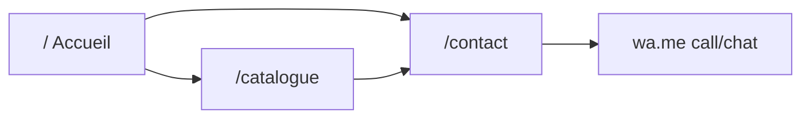

---
name: SDS website remake
overview: "Rebuild sds.sn from scratch as a fast, French-only, photo-led site: Accueil, Catalogue, Contact (WhatsApp). Semantic HTML and structured data so search/AI can actually understand the business."
todos:
  - id: scaffold
    content: Scaffold Next.js App Router + Tailwind, static export, tokens (#FF5E14, charcoal, warm paper), layout/nav using Logo SVG
    status: in_progress
  - id: copy-seo
    content: French copy + metadata, JSON-LD, sitemap, robots, llms.txt; WhatsApp number as a single config value
    status: pending
  - id: home
    content: Build photography-led Accueil (hero, métiers index, atelier sequence, selected works, WhatsApp close)
    status: pending
  - id: catalogue
    content: Copy photos to public/photos with slugs, generate catalogue.ts from the 11 folders, filters + lazy grid + lightbox
    status: pending
  - id: contact
    content: "Build /contact with WhatsApp primary CTA and tel: fallback"
    status: pending
  - id: verify
    content: Responsive browser pass on all three routes and WhatsApp link
    status: pending
isProject: false
---

# Sénégal Découpe Services website remake

## What we keep from the current site

[sds.sn](https://sds.sn) is a leftover WordPress theme (“Cats And Dogs”): English placeholder copy, fake New York address, fake team, title tag wrong. The **only real business content** is French:

- Custom high-end kitchens, locally made
- Also: salles de bain, dressing, rangements, portes, meubles, revêtement mural, vitrage aluminium, meubles TV, consoles
- Existing geometric SDS logo: [`Logo/Logo Sénégal Découpe.svg`](D:\SDS Redesign\Logo\Logo Sénégal Découpe.svg) (mark + wordmark, charcoal `#231f20` and orange `#f36d2c`)

We will **not** copy template sections, fake testimonials, or English slogans.

## Stack

- **Next.js (App Router) + TypeScript + Tailwind CSS**, static export (`output: 'export'`) so it can replace the current WordPress site on `sds.sn` (cPanel/FTP) or go to Vercel
- `next/font` with **one sans family** (Geist or Plus Jakarta Sans). No mixed serif gimmicks
- `next/image` for responsive photos
- No CMS for v1: catalogue lives in a typed array in `[src/data/catalogue.ts](src/data/catalogue.ts)`

## Visual direction (anti-cliché)

Palette: charcoal `#111111`, warm paper `#F4F1EC`, ink grey, solid accent `**#FF5E14**`. Sharp edges (0–4px radius). No pills over the H1, no aurora glows, no numbered 01/02/03 feature grid, no emojis, no em-dash marketing copy.

Layout language: **joinery / atelier**. Full-bleed photography, generous whitespace, thin rules, left-aligned type. Orange is for buttons, active nav, and a few hard lines, not decoration.

## Site map

Nav: Accueil, Catalogue, Contact. Persistent orange CTA: **Devis WhatsApp**.

### 1. Accueil (strong landing)

- Full-viewport hero using a real SDS photo (not stock glass towers)
- Headline that states the work, e.g. **Cuisines et aménagements sur mesure, fabriqués au Sénégal**
- Short supporting line from the existing French paragraph (rewritten, not lorem)
- Two actions: **Voir le catalogue** / **Parler sur WhatsApp**
- **Métiers** as a photo index using one strong image per real folder (see asset map). Group Portes (alu + bois laminé) on the home index; keep them as two filters in the catalogue. Not a 3-column numbered icon grid
- Short atelier block (local fabrication, mesure, conception, pose) as a vertical sequence, not “01 02 03 cards”
- Selected works strip (4–6 photos) linking to `/catalogue`
- Closing band: one sentence + WhatsApp

### 2. Catalogue (gallery)

- Filter chips matching the 11 folders: Tous, Cuisine américaine, Dressing, Portes alu, Portes bois, Meubles TV, Meubles bureau, Lits et armoires, Consoles 3D, Revêtements muraux, Cloisons, Lavabo
- Responsive masonry/grid of the real JPGs (`figure` + `figcaption`)
- Lazy-load + “afficher plus” per filter (Meubles TV alone is 82 files; ~283 total)
- Lightbox (keyboard accessible)
- French `alt` from category + index (filenames are WhatsApp dumps like `PHOTO-2026-08-03-…`)

### 3. Contact (WhatsApp)

A real crawlable page (better for search than a silent redirect) whose **primary action is WhatsApp**.

- Headline + one line: devis, rendez-vous, appel
- Large button: **Appeler / écrire sur WhatsApp** → `https://wa.me/221XXXXXXXXX` (number you will send after this plan)
- Secondary `tel:` link with the same number
- Placeholders for address and hours until you confirm them (no New York leftovers)
- Optional Google Maps embed only if you provide a real address

## AI / search readability (Gemini, Google)

- `lang="fr"` on `<html>`, unique `<title>` and meta description per page
- Semantic landmarks: `header`, `nav`, `main`, `footer`, one `h1` per page, `article`/`figure`
- JSON-LD: `LocalBusiness` (or `HomeAndConstructionBusiness`), `Organization`, `WebSite`, `BreadcrumbList`, `ImageGallery` on catalogue
- Open Graph + Twitter cards with a real project photo
- `[public/robots.txt](public/robots.txt)`, `[app/sitemap.ts](app/sitemap.ts)`, canonical URLs on `https://sds.sn`
- `[public/llms.txt](public/llms.txt)`: short French company description for AI crawlers
- Fast, indexable HTML (static export), compressed images, no client-only content walls

## Assets (already in the workspace)

**Logo:** [`Logo/Logo Sénégal Découpe.svg`](D:\SDS Redesign\Logo\Logo Sénégal Découpe.svg). Copy to `public/brand/logo.svg`. Constrain header height (~40–48px); the SVG viewBox is wide (1867×1004) and includes the mark plus stacked wordmark. On the dark hero, invert/recolor fills to white + `#FF5E14` so it stays readable.

**Photos:** [`photos/`](D:\SDS Redesign\photos) (~283 JPG/JPG). Copy into `public/photos/` with URL-safe slugs (accents in folder names break some hosts). Generate [`src/data/catalogue.ts`](src/data/catalogue.ts) from the folders. Hero: a Cuisine américaine shot (full kitchens) or a Portes alu `IMG_*` if we want a clearly photographic image.

- `Cuisine Américaine` → Cuisine américaine (50)
- `Dressing` → Dressing (5)
- `Lavabo` → Lavabo / salle d’eau (6)
- `Lits-Armoire-Coiffeuses` → Lits, armoires, coiffeuses (21)
- `Meubles Bureau` → Meubles de bureau (38)
- `Meubles TV` → Meubles TV (82)
- `Consoles Panneaux 3d` → Consoles et panneaux 3D (14)
- `Cloison` → Cloisons (15)
- `Revetements Mural` → Revêtements muraux (12)
- `Portes Alu et Baie Vitrée Coulissante` → Portes alu et baies (30)
- `Portes Bois laminé` → Portes bois laminé (10)

Keep originals in `photos/` for the client; the app serves only `public/photos/`. Skip obviously broken files (e.g. tiny 8KB shots) during copy.

## Out of scope for v1

- English toggle, blog, fake testimonials, fake team, online checkout
- Recreating the WordPress theme

## Verification

After build: run locally, walk Accueil → Catalogue filters → lightbox → Contact → WhatsApp link in the browser at desktop and a mobile viewport. Confirm headings, alts, and JSON-LD in page source.
